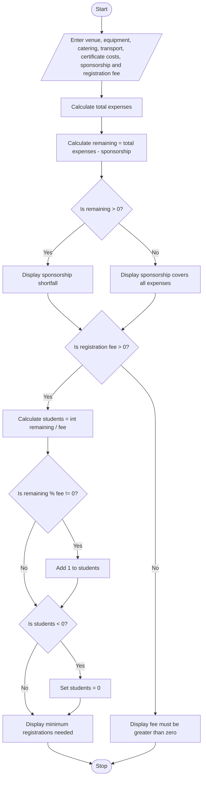

### Case Study 10: Campus Event Financial Planning

### 1\. Problem Statement

To calculate the total expenses of a campus event, check whether sponsorship covers the expenses, and find the minimum number of student registrations needed to cover any shortfall.

### 2\. Algorithm

* Start.

* Read the event costs, sponsorship amount, and registration fee.

* Calculate the total expenses.

* Subtract sponsorship from total expenses.

* Display the sponsorship shortfall or a message that sponsorship covers all expenses.

* If the registration fee is greater than zero, calculate the minimum registrations needed.

* Display the result.

* Stop.

### 3\. Flowchart



### 4\. Sample Input

```text
Enter venue cost: 10000
Enter equipment cost: 5000
Enter catering cost: 20000
Enter transport cost: 3000
Enter certificate cost: 2000
Enter sponsorship amount: 25000
Enter registration fee per student: 500
```

### 5\. Sample Output

```text
Total Event Expenses: 40000.0
Sponsorship Shortfall: 15000.0
Minimum Registrations Needed: 30
```

### 6\. Explanation

* Total expenses = ₹40,000.

* Sponsorship = ₹25,000, so the shortfall is ₹15,000.

* Each student pays ₹500.

* The program calculates 15,000 ÷ 500 = 30 registrations.

