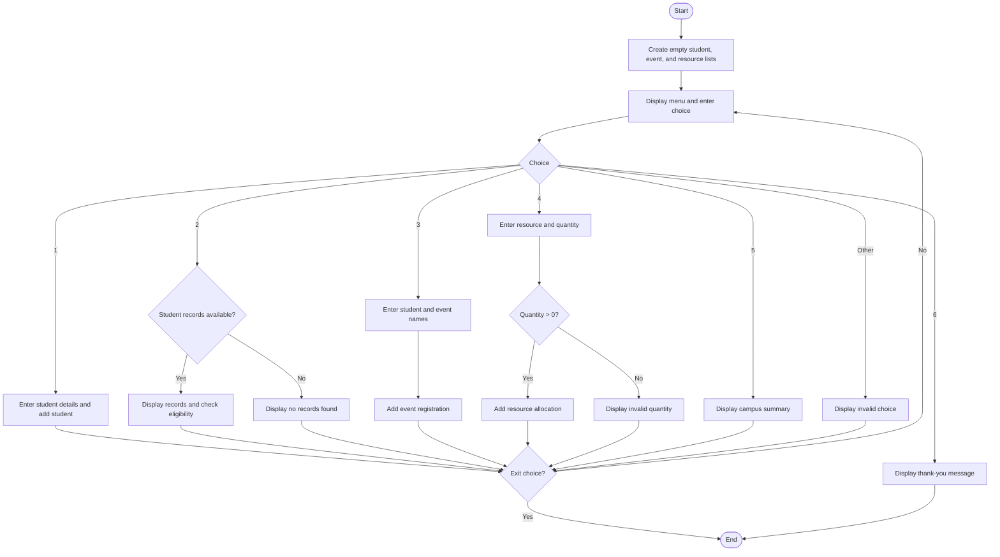

### Case Study 100: Smart Campus Management

### 1\. Problem Statement

Create a menu-driven program to manage student records, event registrations, and resource allocations, and display a campus summary.

### 2\. Algorithm

* Create empty lists for students, events, and resources.

* Display the menu and ask the user to enter a choice.

* If the choice is 1, add a student’s name, attendance, and marks.

* If the choice is 2, display student records and check eligibility.

* If the choice is 3, register a student for an event.

* If the choice is 4, allocate a resource if the quantity is positive.

* If the choice is 5, display the total students, event registrations, and resource allocations.

* If the choice is 6, display the exit message and stop.

* Otherwise, display an invalid-choice message.

### 3\. Flowchart



### 4\. Sample Input

```text
1
Ravi
80
65
3
Ravi
Sports Day
4
Projector
2
5
6
```

### 5\. Sample Output

```text
--- SMART CAMPUS MANAGEMENT ---
1. Add Student
2. View Students
3. Register for Event
4. Allocate Resources
5. View Summary
6. Exit
Enter your choice: 1
Enter student name: Ravi
Enter attendance percentage: 80
Enter marks: 65
Student added successfully

--- SMART CAMPUS MANAGEMENT ---
Enter your choice: 3
Enter student name: Ravi
Enter event name: Sports Day
Event registration successful

--- SMART CAMPUS MANAGEMENT ---
Enter your choice: 4
Enter resource name: Projector
Enter quantity: 2
Resource allocated successfully

--- SMART CAMPUS MANAGEMENT ---
Enter your choice: 5

--- CAMPUS SUMMARY ---
Total Students: 1
Total Event Registrations: 1
Total Resource Allocations: 1

Event Registrations:
Ravi - Sports Day

Resource Allocations:
Projector - 2

--- SMART CAMPUS MANAGEMENT ---
Enter your choice: 6
Thank you for using Smart Campus Management
```
