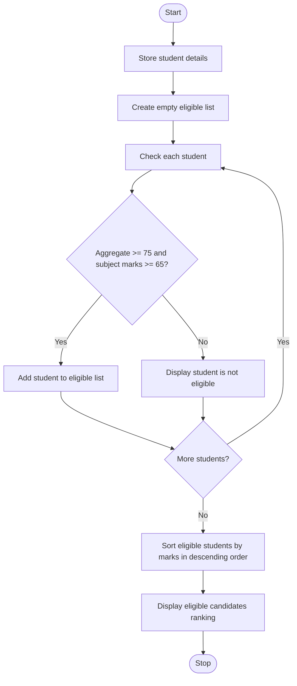

### Case Study 20: University Admission Decision Engine

### 1\. Problem Statement

To check students’ eligibility for university admission based on aggregate and subject marks, then rank eligible candidates from highest to lowest marks.

### 2\. Algorithm

* Start.

* Store the students’ names, aggregate marks, and subject marks.

* Create an empty list for eligible students.

* Check each student’s marks.

* If aggregate marks are at least 75 and subject marks are at least 65, add the student to the eligible list.

* Otherwise, display that the student is not eligible.

* Sort eligible students by aggregate marks and subject marks in descending order.

* Display the ranked list.

* Stop.

### 3\. Flowchart




### 4\. Sample Input

The student details are already given in the program:

* Ravi: Aggregate 85, Subject 75

* Priya: Aggregate 92, Subject 80

* Rahul: Aggregate 68, Subject 60

* Sneha: Aggregate 78, Subject 65

* Anu: Aggregate 95, Subject 90

### 5\. Sample Output

```text
Rahul is not eligible

Eligible Candidates Ranking
1 Anu Aggregate: 95 Subject Marks: 90
2 Priya Aggregate: 92 Subject Marks: 80
3 Ravi Aggregate: 85 Subject Marks: 75
4 Sneha Aggregate: 78 Subject Marks: 65
```


