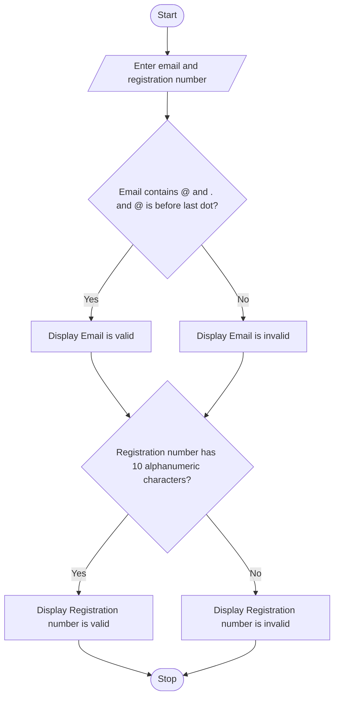

### Case Study 30: Student Email and Identifier Validation

### 1\. Problem Statement

To check whether a student's email address and registration number are valid using simple conditions.

### 2\. Algorithm

* Start.

* Read the student's email and registration number.

* Check whether the email contains `@` and `.`, and whether `@` appears before the last dot.

* Display whether the email is valid or invalid.

* Check whether the registration number has exactly 10 characters and contains only letters and numbers.

* Display whether the registration number is valid or invalid.

* Stop.

### 3\. Flowchart



### 4\. Sample Input

```text
Enter student email: student@gmail.com
Enter registration number: AIML123456
```

### 5\. Sample Output

```text
Email is valid
Registration number is valid
```
