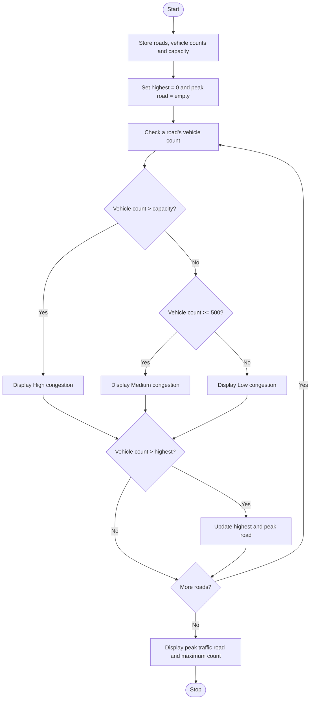

### Case Study 40: Traffic Flow and Congestion Analysis

### 1\. Problem Statement

To analyze vehicle counts on different roads, classify congestion as High, Medium, or Low, and identify the road with the highest traffic.

### 2\. Algorithm

* Start.

* Store road names, vehicle counts, and road capacity.

* Set the highest vehicle count to 0.

* Check each road’s vehicle count.

* If the count is above capacity, display High congestion.

* If the count is 500 or more but not above capacity, display Medium congestion.

* Otherwise, display Low congestion.

* Find and display the road with the highest vehicle count.

* Stop.

### 3\. Flowchart



### 4\. Sample Input

The road details are already given in the program:

* Road A: 450 vehicles

* Road B: 800 vehicles

* Road C: 600 vehicles

* Capacity: 700 vehicles

### 5\. Sample Output

```text
Road: Road A
Vehicle Count: 450
Congestion: Low

Road: Road B
Vehicle Count: 800
Congestion: High

Road: Road C
Vehicle Count: 600
Congestion: Medium

Peak Traffic Road: Road B
Maximum Vehicle Count: 800
```
