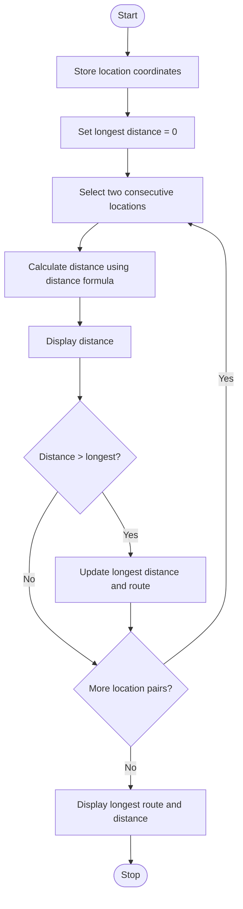

### Case Study 50: Route Distance Analysis

### 1\. Problem Statement

To calculate the distance between consecutive locations and identify the longest route segment.

### 2\. Algorithm

* Start.

* Store the coordinates of the locations.

* Set the longest distance to 0.

* Take each pair of consecutive locations.

* Calculate the distance using the distance formula.

* Display the distance between the locations.

* If the distance is greater than the longest distance, update the longest distance and route.

* Display the longest route segment and its distance.

* Stop.

### 3\. Flowchart



### 4\. Sample Input

The coordinates are already given in the program:

* (0, 0)

* (3, 4)

* (6, 8)

* (12, 8)

### 5\. Sample Output

```text
Distance from (0, 0) to (3, 4) = 5.0
Distance from (3, 4) to (6, 8) = 5.0
Distance from (6, 8) to (12, 8) = 6.0

Longest Route Segment: ((6, 8), (12, 8))
Longest Distance: 6.0
```
