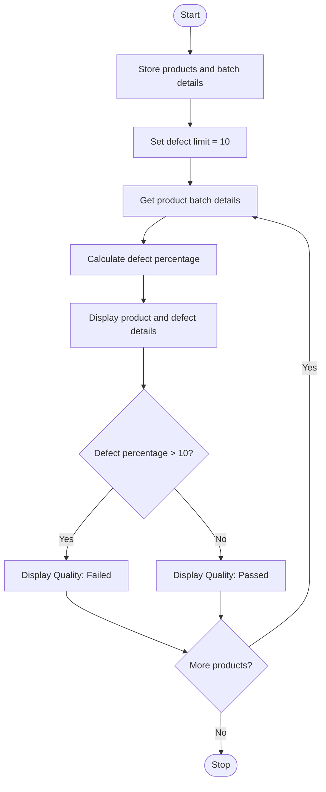

### Case Study 60: Quality Control

### 1\. Problem Statement

To calculate the defect percentage of each product batch and check whether it passes or fails the quality limit of 10%.

### 2\. Algorithm

* Start.

* Store product names and batch details.

* Set the defect percentage limit to 10.

* For each product, calculate the defect percentage.

* Display the product name, produced quantity, defective quantity, and defect percentage.

* If the percentage is greater than 10, display “Quality: Failed”.

* Otherwise, display “Quality: Passed”.

* Stop.

### 3\. Flowchart



### 4\. Sample Input

The product and batch details are already given in the program:

* Product A: 100 produced, 5 defective

* Product B: 200 produced, 30 defective

* Product C: 150 produced, 10 defective

* Defect limit: 10%

### 5\. Sample Output

```text
Product: Product A
Produced: 100
Defective: 5
Defect Percentage: 5.0 %
Quality: Passed

Product: Product B
Produced: 200
Defective: 30
Defect Percentage: 15.0 %
Quality: Failed

Product: Product C
Produced: 150
Defective: 10
Defect Percentage: 6.67 %
Quality: Passed
```
