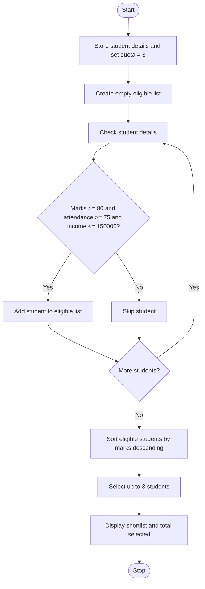

### Case Study 70: Scholarship Shortlisting

### 1\. Problem Statement

To select students for a scholarship based on marks, attendance, and family income, then shortlist up to 3 eligible students in descending order of marks.

### 2\. Algorithm

* Start.

* Store student details and set the scholarship quota to 3.

* Create an empty list for eligible students.

* Check each student’s marks, attendance, and income.

* Add students who have marks of at least 80, attendance of at least 75, and income of at most ₹150,000.

* Sort eligible students by marks from highest to lowest.

* Select up to 3 students and display their details.

* Display the total number selected.

* Stop.

### 3\. Flowchart



### 4\. Sample Input

The student details and quota are already given in the program:

* Ravi: Marks 85, Attendance 90, Income ₹150,000

* Priya: Marks 95, Attendance 95, Income ₹100,000

* Rahul: Marks 70, Attendance 80, Income ₹120,000

* Sneha: Marks 88, Attendance 85, Income ₹200,000

* Anu: Marks 92, Attendance 92, Income ₹90,000

* Quota: 3 students

### 5\. Sample Output

```text
Scholarship Shortlist:
1 Priya Marks: 95 Attendance: 95 Income: 100000
2 Anu Marks: 92 Attendance: 92 Income: 90000
3 Ravi Marks: 85 Attendance: 90 Income: 150000
Total Selected: 3
```
