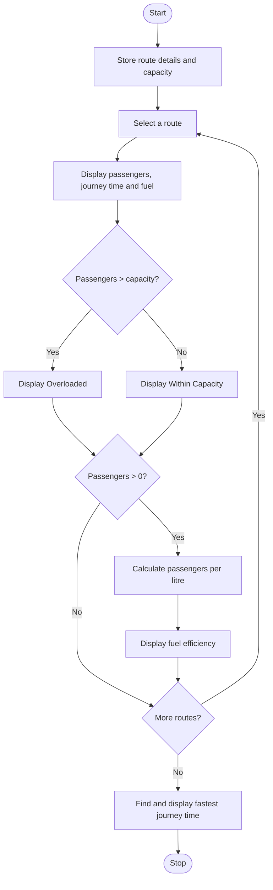

### Case Study 80: Bus Route Performance

### 1\. Problem Statement

To check the passenger capacity and fuel efficiency of different bus routes, and find the fastest journey time.

### 2\. Algorithm

* Start.

* Store route names, passenger counts, journey times, and fuel used.

* Set the bus capacity to 50 passengers.

* For each route, display its details.

* If passengers exceed 50, display “Overloaded”; otherwise, display “Within Capacity”.

* Calculate and display passengers per litre of fuel.

* Find and display the shortest journey time.

* Stop.

### 3\. Flowchart



### 4\. Sample Input

The route details are already given in the program:

* Route A: 45 passengers, 40 minutes, 8 litres

* Route B: 60 passengers, 55 minutes, 12 litres

* Route C: 35 passengers, 30 minutes, 6 litres

* Capacity: 50 passengers

### 5\. Sample Output

```text
Route: Route A
Passengers: 45
Journey Time: 40 minutes
Fuel Used: 8 litres
Status: Within Capacity
Passengers per Litre: 5.62

Route: Route B
Passengers: 60
Journey Time: 55 minutes
Fuel Used: 12 litres
Status: Overloaded
Passengers per Litre: 5.0

Route: Route C
Passengers: 35
Journey Time: 30 minutes
Fuel Used: 6 litres
Status: Within Capacity
Passengers per Litre: 5.83

Fastest Journey Time: 30 minutes
```
