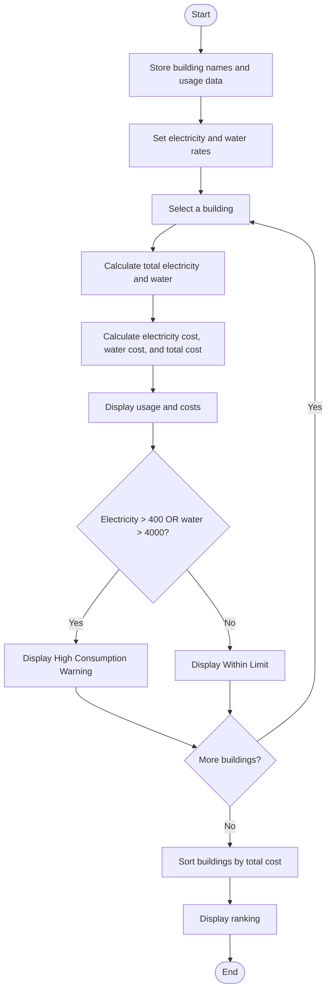

### Case Study 90: Campus Energy and Water Audit

### 1\. Problem Statement

Calculate each building’s electricity and water usage costs, check whether consumption is high, and rank buildings by total cost.

### 2\. Algorithm

* Store building names, electricity usage, and water usage.

* Set electricity rate to ₹8 per unit and water rate to ₹0.05 per litre.

* For each building, calculate total electricity and water usage.

* Calculate electricity cost, water cost, and total cost.

* Display the costs and check whether electricity usage is above 400 units or water usage is above 4000 litres.

* Sort buildings by total cost in descending order and display the ranking.

### 3\. Flowchart



### 4\. Sample Input

The building names and usage values are already given in the program.

### 5\. Sample Output

```text
Building: Block A
Electricity Units: 330
Water Used: 3150 litres
Electricity Cost: Rs. 2640
Water Cost: Rs. 157.5
Total Cost: Rs. 2797.5
Consumption: Within Limit

Building: Block B
Electricity Units: 600
Water Used: 6300 litres
Electricity Cost: Rs. 4800
Water Cost: Rs. 315.0
Total Cost: Rs. 5115.0
Warning: High Consumption

Building: Block C
Electricity Units: 255
Water Used: 2550 litres
Electricity Cost: Rs. 2040
Water Cost: Rs. 127.5
Total Cost: Rs. 2167.5
Consumption: Within Limit

Buildings Ranked by Total Cost:
Block B - Rs. 5115.0
Block A - Rs. 2797.5
Block C - Rs. 2167.5
```
